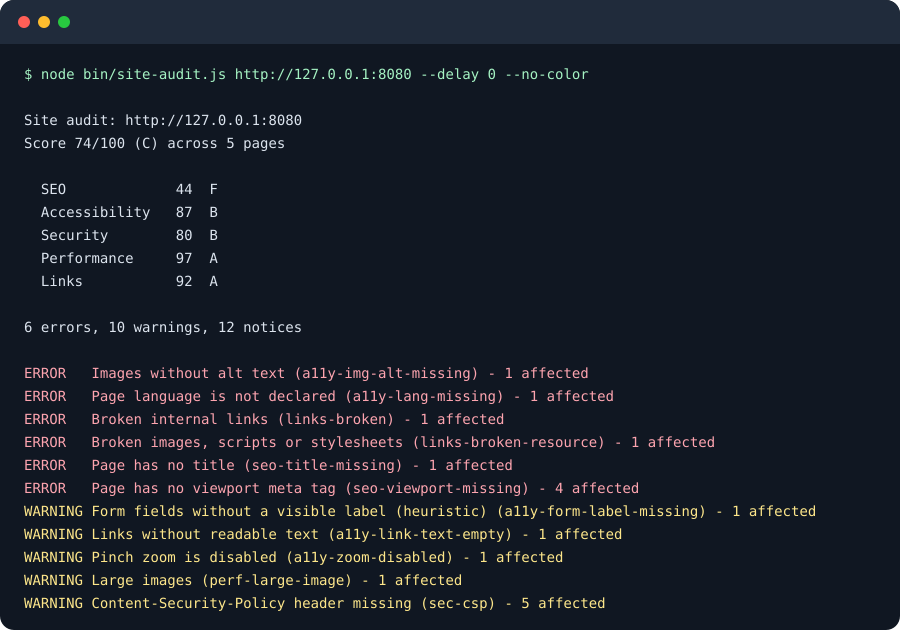

# site-audit-lite

[](https://github.com/YusufBeratZengin/site-audit-lite/actions/workflows/ci.yml) [](LICENSE) [](https://nodejs.org/) [](https://www.npmjs.com/package/site-audit-lite)

[English](README.md) | [Türkçe](README.tr.md)

Küçük işletme siteleri için çalışma zamanı bağımlılığı olmayan, hızlı bir site denetim aracı.



[Hızlı başlangıç](#hızlı-başlangıç) · [Kullanım](#kullanım) · [Yapılandırma](#yapılandırma-ve-seçenekler) · [Kontroller](#neleri-kontrol-eder) · [SSS](#sık-sorulan-sorular-ve-sınırlar) · [Katkıda bulunma](#katkıda-bulunma)

## Neden bu araç?

- **Kolay kurulum:** Node.js 20 ve üzeri, yerleşik `fetch`; tarayıcı indirmesi veya çalışma zamanı bağımlılığı gerekmez.
- **Açıklanabilir bulgular:** SEO, erişilebilirlik, güvenlik, performans ve bağlantılar için 44 kontrol; her bulguda kanıt ve çözüm önerisi.
- **Raporlar sizin kontrolünüzde:** bağımsız HTML, Markdown ve JSON çıktıları; yerel işlem, robots.txt desteği ve CI için önceki raporla karşılaştırma.

## Hızlı başlangıç

Kendi sitenizi hazırlamadan, sentetik yerel site üzerinde tam bir demo çalıştırın:

```sh
git clone https://github.com/YusufBeratZengin/site-audit-lite.git
cd site-audit-lite
npm ci
node scripts/make-demo.mjs
```

Node.js 20 veya üzeri ve boş bir yerel 8080 portu gerekir. `npm ci` geliştirme araçlarını kurar; CLI için paket kurulumu gerekmez. Demo, gerçek CLI özetini yazdırır ve ilk 22 çıktı satırından `docs/demo.svg` dosyasını yeniden üretir. npm rozeti paket kayıt sistemini gösterir; paket yayımlanana kadar “package not found” görünebilir. Kaynak koddan kullanım bundan bağımsızdır.

Kendi yerel siteniz için `node bin/site-audit.js http://127.0.0.1:8080` komutunu çalıştırın. `site-audit` komutunu her yerden kullanmak isterseniz `npm link` çalıştırabilirsiniz.

## Demo

Görseldeki komutu aynen çalıştırmak için önce bir terminalde sentetik siteyi başlatın:

```sh
node scripts/make-demo.mjs --serve
```

Başka bir terminalde, depo kök dizininden şu komutu çalıştırın:

```sh
node bin/site-audit.js http://127.0.0.1:8080 --delay 0 --no-color
```

Örnek sunucuyu Ctrl+C ile durdurun. Tam rapor örneklerini üretmek için `node scripts/make-example.mjs` çalıştırın; ardından `examples/report.html` veya `examples/report.md` dosyasını açın. Her iki demo betiği de sentetik veri kullanır; dışarıdaki sitelere istek göndermez.

## Kullanım

Bu komutlar, 8080 portunda çalışan yerel bir site gerektirir; kendi sitenizi veya yukarıdaki demo sunucusunu kullanabilirsiniz.

```sh
node bin/site-audit.js http://127.0.0.1:8080
node bin/site-audit.js http://127.0.0.1:8080 --max-pages 20 --out report.html
node bin/site-audit.js http://127.0.0.1:8080 --out report.md --out report.json
node bin/site-audit.js http://127.0.0.1:8080 --fail-under 80 --quiet
```

Protokol yazılmadan verilen alan adları HTTPS olarak kabul edilir. Yerel HTTP sunucuları için `http://` önekini açıkça yazın.

## Yapılandırma ve seçenekler

| Seçenek | Varsayılan | Anlamı |
| --- | --- | --- |
| `--max-pages <n>` | 20 | Çekilecek en fazla sayfa sayısı |
| `--max-depth <n>` | 3 | Başlangıç sayfasından en fazla bağlantı derinliği |
| `--concurrency <n>` | 4 | Eşzamanlı istek sayısı |
| `--delay <ms>` | 200 | İstekler arası en kısa bekleme (robots.txt içindeki daha büyük bir `Crawl-delay` geçerli olur, en çok 10 sn) |
| `--timeout <ms>` | 15000 | İstek başına zaman aşımı |
| `--user-agent <metin>` | `site-audit-lite/0.1 (+depo adresi)` | User-Agent başlığı; ilk kelimesi robots.txt gruplarını eşleştirmek için de kullanılır |
| `--out <dosya>` | yok | Rapor yazar. Biçim uzantıdan belirlenir (`.html`, `.md`, `.json`). Birden fazla kez verilebilir |
| `--format <biçim>` | uzantıya göre | Tüm `--out` dosyaları için `html`, `md` veya `json` biçimini zorlar |
| `--fail-under <n>` | yok | Genel puan `n` değerinin altındaysa 1 koduyla çıkar |
| `--baseline <dosya>` | yok | Önceki JSON raporuyla kontrol kimliği ve etkilenen URL üzerinden karşılaştırır |
| `--fail-on-new <önem>` | yok | Yeni bulgu bu önem düzeyinde veya üzerindeyse 1 koduyla çıkar; `--baseline` gerekir (`error`, `warning`, `info`) |
| `--allow-private` | kapalı | Güvenilen hedeflerde özel adres engelini kaldırır; origin sınırı korunur |
| `--verbose` | kapalı | Terminalde çözümleri, kanıtları ve ilerleme iletilerini gösterir |
| `--quiet` | kapalı | Hata dışında hiçbir şey yazmaz |
| `--no-color` | otomatik | ANSI renklerini kapatır |

Çıkış kodları: `0` başarılı, `1` puan `--fail-under` değerinin altında veya yeni bulgular `--fail-on-new` eşiğini karşılıyor, `2` kullanım hatası ya da site denetlenemedi.

### Kütüphane olarak kullanım

```js
import { runAudit, renderHtml } from 'site-audit-lite';

const result = await runAudit('http://127.0.0.1:8080', { maxPages: 10 });
console.log(result.scores.overall, result.findings.length);
const html = renderHtml(result);
```

## Neleri kontrol eder

Önem derecesi `error` (hata), `warning` (uyarı) veya `info` (bilgi) olur. Kapsam `page` ise kontrol denetlenen her sayfada, `site` ise bütün sitede bir kez çalışır.

### SEO

| Kimlik | Önem | Kapsam | Ne |
| --- | --- | --- | --- |
| `seo-hreflang-invalid` | warning | page | Hreflang dil kodu geçersiz veya sayfanın kendisine referans yok |
| `seo-title-too-generic` | warning | page | Home veya Untitled gibi genel bir başlık |
| `seo-title-missing` | error | page | Sayfanın başlığı yok |
| `seo-title-length` | warning | page | Başlık 10 karakterden kısa ya da 60 karakterden uzun |
| `seo-title-duplicate` | warning | site | Birkaç sayfa aynı başlığı paylaşıyor |
| `seo-description-missing` | warning | page | Meta açıklaması yok |
| `seo-description-length` | info | page | Açıklama 70 karakterden kısa ya da 160 karakterden uzun |
| `seo-h1-missing` | warning | page | h1 başlığı yok |
| `seo-h1-multiple` | info | page | Birden fazla h1 var |
| `seo-canonical-missing` | info | page | Canonical bağlantısı yok |
| `seo-viewport-missing` | error | page | Viewport meta etiketi yok |
| `seo-noindex` | warning | page | Robots meta etiketinde ya da X-Robots-Tag başlığında `noindex` var |
| `seo-opengraph-missing` | info | page | og:title, og:description veya og:image eksik |
| `seo-structured-data-missing` | info | page | JSON-LD bloğu yok |
| `seo-robots-txt-missing` | info | site | `/robots.txt` bulunamadı |
| `seo-sitemap-missing` | warning | site | Site haritası bulunamadı (robots.txt içindeki `Sitemap:` satırı, yoksa `/sitemap.xml`) |
| `seo-favicon-missing` | info | site | Favicon yok (tanımlı simge, yoksa `/favicon.ico`) |

### Erişilebilirlik

Bunlar temel ve sezgisel kontrollerdir; elle inceleme yapmanın ya da axe gibi eksiksiz bir aracın yerini tutmaz.

| Kimlik | Önem | Kapsam | Ne |
| --- | --- | --- | --- |
| `a11y-heading-order` | warning | page | Başlık düzeyleri atlanıyor veya ilk başlık h1 değil |
| `a11y-button-name-missing` | error | page | Düğmenin erişilebilir adı yok (sezgisel) |
| `a11y-lang-missing` | error | page | `<html>` öğesinde `lang` yok |
| `a11y-img-alt-missing` | error | page | `alt` özniteliği olmayan görseller (boş `alt=""` kabul edilir) |
| `a11y-form-label-missing` | warning | page | `<label>`, `aria-label`, `aria-labelledby` ya da `title` olmayan form alanları (sezgisel) |
| `a11y-link-text-empty` | warning | page | Metni, aria-label'ı ya da görsel alt metni olmayan bağlantılar |
| `a11y-zoom-disabled` | warning | page | Viewport yakınlaştırmayı engelliyor (`user-scalable=no`, 2'den küçük `maximum-scale`) |

### Güvenlik

| Kimlik | Önem | Kapsam | Ne |
| --- | --- | --- | --- |
| `sec-cookie-flags` | warning | page | Set-Cookie içinde Secure, HttpOnly veya geçerli SameSite eksik |
| `sec-https` | error | site | Site düz HTTP ile sunuluyor |
| `sec-https-redirect` | warning | site | `http://` adresi `https://` adresine yönlenmiyor |
| `sec-hsts` | warning | page | `Strict-Transport-Security` yok |
| `sec-csp` | warning | page | `Content-Security-Policy` yok |
| `sec-x-content-type-options` | warning | page | `X-Content-Type-Options` eksik ya da yanlış |
| `sec-referrer-policy` | info | page | `Referrer-Policy` yok |
| `sec-frame-protection` | info | page | Ne `X-Frame-Options` ne de CSP `frame-ancestors` var |
| `sec-mixed-content` | error | page | HTTPS sayfası `http://` betik, stil, çerçeve ya da görsel yüklüyor |

Yerel geliştirme sunucusunu denetleyebilmeniz için döngü adresleri (`localhost`, `127.0.0.0/8`, `::1`) HTTPS, HTTP yönlendirmesi ve HSTS kontrollerinden muaftır.

### Performans

| Kimlik | Önem | Kapsam | Ne |
| --- | --- | --- | --- |
| `perf-no-cache-headers` | info | page | Aynı sitedeki statik kaynakta Cache-Control ve Expires yok |
| `perf-page-weight` | warning | page | HTML ile aynı siteden görseller, betikler ve stiller toplamı 1,5 MB'ı aşıyor |
| `perf-html-size` | info | page | Yalnızca HTML 200 KB'ı aşıyor |
| `perf-large-image` | warning | page | Aynı siteden 300 KB'ı aşan görsel |
| `perf-compression` | warning | page | 2 KB'dan büyük HTML `Content-Encoding` olmadan sunuluyor |
| `perf-slow-response` | warning | page | Sayfanın inmesi 1,5 saniyeden uzun sürdü |
| `perf-img-dimensions` | info | page | `width` ve `height` olmayan görseller |
| `perf-render-blocking-script` | info | page | `<head>` içinde `async`, `defer` ya da `type="module"` olmayan dış betik |

Boyutlar, çözülmüş HTML gövdesinden ve aynı siteden kaynakların `Content-Length` başlıklarından alınır. `Content-Length` göndermeyen kaynaklar sayılmaz; bu yüzden sayfa ağırlığı alt sınırdır.

### Bağlantılar

| Kimlik | Önem | Kapsam | Ne |
| --- | --- | --- | --- |
| `links-broken` | error | page | Site içi bağlantı 4xx/5xx döndürüyor ya da açılamıyor |
| `links-broken-resource` | error | page | Aynı siteden görsel, betik ya da stil dosyası 4xx/5xx döndürüyor ya da açılamıyor |
| `links-redirected` | info | page | Site içi bağlantı başka bir adrese yönleniyor |

Yalnızca aynı kaynaktaki (origin) bağlantılar denetlenir. Dış bağlantılara hiçbir zaman istek atılmaz.

## Örnekler

`node scripts/make-example.mjs` yalnızca `test/support/fixtures.js` içindeki sentetik veriyi kullanır; gerçek bir siteye istek göndermez. `examples/report.html` ve `examples/report.md` dosyalarını yeniden üretir. `SITE_AUDIT_NOW` ortam değişkenine ISO tarih vererek zamanı sabitleyebilirsiniz; varsayılan örnek zamanı `2026-10-22T00:00:00Z` değeridir. Kaydedilen raporlarda rastgele yerel port 8080, süreler sıfır olarak gösterilir. `node scripts/make-demo.mjs` ise terminal SVG'si için CLI çıktısını doğrudan yakalar.

## Nasıl çalışır

Önce robots.txt okunur; ardından sayfalar genişlik öncelikli taranır. Aynı origin içindeki bağlantı ve kaynaklar kontrol edilir; katalogdaki kontroller kanıt ve çözüm üretir. Sayfa bütçesi bağlantı kontrollerini tamamen sınırlamaz: keşfedilen aynı origin bağlantıları ayrıca HEAD isteğiyle kontrol edilebilir.

## Puanlama

Her kategori 100 puanla başlar. Başarısız her kontrol önem derecesine göre puan düşürür: hata 20, uyarı 8, bilgi 2. Sayfa kapsamlı bir kontrolün düşüşü, etkilediği sayfa oranıyla ölçeklenir (6 sayfanın 3'ü etkileniyorsa düşüşün yarısı uygulanır); site kapsamlı kontrol her zaman tam düşer. Kategori puanı 0 ile 100 arasında tutulur.

Katalogdaki 44 kontrolün tamamı bu kurala tabidir; her kontrol tablolarda belirtilen önem derecesini ve kapsamı kullanır.

Genel puan, kategori puanlarının ağırlıklı ortalamasıdır:

| Kategori | Ağırlık |
| --- | ---: |
| SEO | 30 |
| Güvenlik | 25 |
| Erişilebilirlik | 20 |
| Performans | 15 |
| Bağlantılar | 10 |

Notlar: 90 ve üzeri A, 80 B, 70 C, 60 D, 60'ın altı F. Puanlar düzeltmeleri sıraya koymak için kaba bir rehberdir; hiçbir arama motorunun sıralama sinyali değildir.

## Raporlar

- Terminal: puanlar, sayılar ve en ciddi bulgular.
- HTML: satır içi CSS'li, betiksiz, açık ve koyu temalı tek dosya; sayfalardan gelen tüm içerik kaçışlanır.
- Markdown: aynı içerik; bir sorun kaydına ya da e-postaya yapıştırmak kolaydır.
- JSON: tüm sonuç nesnesi (`scores`, `summary`, `pages`, `affected[].evidence` içeren `findings`).

`--baseline previous.json`, bulguları ve etkilenen URL'leri HTML ve Markdown raporlarında `new` (yeni), `fixed` (düzeltilmiş) veya `unchanged` (değişmemiş) olarak işaretler. Eşleştirme kontrol kimliği ve URL ile yapılır; yalnızca kanıtın değişmesi yeni bulgu sayılmaz. Bir kontrol hem yeni hem değişmemiş URL'ler içerebilir; bunlar ayrı ayrı işaretlenir. Düzeltilmiş bulgular güncel puanı etkilemez. `--fail-on-new error` yalnızca yeni hatalar varsa 1 koduyla çıkar. JSON karşılaştırmasında mevcut alanlara `status` ve `baseline` verileri eklenir.

## Sık sorulan sorular ve sınırlar

### JavaScript çalıştırır mı, tam erişilebilirlik denetiminin yerini tutar mı?

Hayır. Sunucudan gelen HTML'yi toleranslı bir ayrıştırıcıyla inceler. JavaScript ile oluşan içerik ve kapsamlı erişilebilirlik değerlendirmesi için tarayıcı tabanlı bir araç ve elle inceleme gerekir.

### CI içinde kullanabilir miyim?

Evet. `--out baseline.json` ile JSON raporu kaydedin; sonraki denetimi `--baseline baseline.json --fail-on-new error` ile karşılaştırın. Genel puan eşiği için `--fail-under 80` kullanın. Puan eşikten düşükse veya belirtilen önem düzeyinde yeni bulgu varsa çıkış kodu 1 olur.

### Raporları dışarıya gönderir mi?

Hayır. Denetim, hedef siteye ve aynı origin içindeki kaynaklarına HTTP istekleri gönderir. Siz paylaşmadıkça raporlar bilgisayarınızda kalır. Paylaşmadan önce URL'leri ve kanıtları gözden geçirin.

### Sınırlar neler?

- Başlangıç URL'si özel veya yerel değilse özel, döngü, link-local, localhost ve bilinen metadata adreslerine yönlendirmeler istek yapılmadan reddedilir. Yönlendirmedeki alan adlarının DNS adresleri de kontrol edilir. `--allow-private` seçeneğini yalnızca güvendiğiniz hedeflerde kullanın; özel veya yerel başlangıç adresleri özel hedeflere izin verir. Aynı sunucuda HTTP'den HTTPS'ye geçiş dışında farklı origin'e yönlendirme yapılmaz.
- Bu önlemler ağ yalıtımı sağlamaz: DNS kontrolü ile bağlantı arasında DNS rebinding gerçekleşebilir. Güvenmediğiniz siteleri ağ erişimi kısıtlı bir ortamda denetleyin. Raporlar URL ve kanıt içerir; paylaşmadan önce inceleyin. Telemetri veya rapor yükleme yapılmaz.
- 429/503 yanıtında geçerli ve en fazla 30 saniyelik `Retry-After` süresi bir kez beklenir; ikinci başarısız yanıttan sonra URL bırakılır. Daha uzun veya geçersiz sürelerde tekrar denenmez. HEAD isteği yalnızca 405/501 yanıtında GET ile tekrarlanır.
- En fazla beş yönlendirme izlenir. Content-Type eksikse içerik HTML olarak ayrıştırılmaz. Gzip/Brotli dahil açılmış gövde 2 MiB ile sınırlıdır; kesilen sayfalar `pages[].truncated` ve rapor etiketiyle belirtilir. Bulgular eksik kalabilir.
- Site haritası indekslerinde aynı origin içindeki alt haritalar bir düzey izlenir; sayı `maxPages` ile sınırlıdır. Haritadaki sayfa URL'leri tarama kuyruğuna eklenmez.
- Hreflang dil kodu ve kendine referans, düğme adı ve başlık sırası kontrolleri sezgiseldir; bölge kayıtları, ARIA referans hedefleri ve görünürlük tam olarak doğrulanmaz. Çerez kontrolü, bilerek betiklere açık bırakılan çerezleri işaretleyebilir. Önbellek kontrolü başlığın varlığına bakar, politikanın doğruluğuna bakmaz.

- Sayfalar küçük ve toleranslı bir ayrıştırıcıyla işlenir. JavaScript ile sonradan eklenen içerik görülmez.
- Kontroller küçük siteler için sezgiseldir. Hepsini geçmek sitenin güvenli, erişilebilir ya da hızlı olduğunu kanıtlamaz.
- `--max-pages`, 404 dönenler dahil tarama sırasındaki her sayfa isteğini sayar.

## Geliştirme

```sh
npm ci
npm test       # yerleşik kapsam raporu; yalnızca sentetik yerel HTTP sunucuları
npm run lint
npm run test:coverage  # Node 22.8+ veya 24: kaynak kodda en az %85 satır kapsamı
```

CI; Ubuntu ve Windows'ta Node 20, 22 ve 24, macOS'ta Node 24 ile çalışır. Bu JavaScript projesinde ayrı bir typecheck komutu bulunmuyor. Bkz. [CONTRIBUTING.md](CONTRIBUTING.md). Güvenlik bildirimleri için: [SECURITY.md](SECURITY.md).

## Katkıda bulunma

Kurulum, katkı kuralları ve sürüm çıkarma için [CONTRIBUTING.md](CONTRIBUTING.md); davranış kuralları için [CODE_OF_CONDUCT.md](CODE_OF_CONDUCT.md).

## Lisans

MIT, bkz. [LICENSE](LICENSE).
